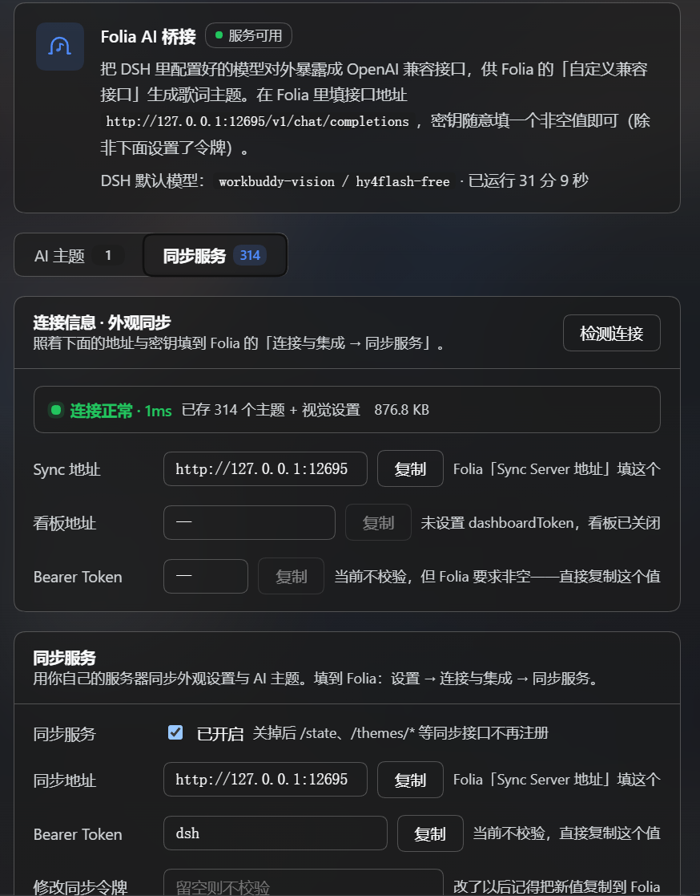

# Folia AI 桥接

一个 DSH 插件，把 DeepSeek Harness 里已经配置好的模型对外暴露成 **OpenAI 兼容接口**，
并自带 **Folia 同步服务** —— 装一个插件，Folia 的 AI 主题和外观同步都齐了。

- **AI 主题**：Folia 用「AI 供应商 → 自定义兼容接口」走 DSH 的模型，不必再准备一份 API 密钥。
- **外观同步**：内置 `folia-major/sync-server` 的完整协议，主题与视觉设置跨设备同步。
- **一键复制**：设置页把所有要填到 Folia 的地址、模型名、密钥都摆出来，点「复制」即可，不用自己拼。

> 需要 [DeepSeek Harness](https://github.com/deepseek-ai) 与自己部署的 [Folia](https://github.com/chthollyphile/folia-major)。
> 本插件是一个 DSH bundle，不是 Folia 模组。

## 截图

设置页分成「AI 主题」与「同步服务」两栏，各自显示连接信息和真实连通性状态。
下图是「同步服务」栏：点几下「复制」就能把地址与 Token 填进 Folia。



## 安装

```powershell
# 在任意目录克隆
git clone https://github.com/songdongze/folia-ai-bridge.git folia-ai-bridge
```

然后在 DSH 里：**插件** → **添加插件** → 选择上面克隆出来的 `folia-ai-bridge` 目录。
安装后设置里会多出「Folia AI 桥接」一页。

## 功能一：AI 主题

1. DSH 设置 → **Folia AI 桥接** → **AI 主题** 栏，确认状态显示「连接正常」。
2. 把这一栏里的三个值复制过去：
   - **接口地址** → Folia「AI 服务 → 接口地址」
   - **模型名** → Folia「模型」（或点「获取模型」挑一个）
   - **API 密钥** → Folia「API 密钥」（本插件默认不校验，Folia 要求非空，直接复制显示的值即可）
3. Folia 里点「测试连接」，显示 `连接成功 · HTTP 200` 即可。

## 功能二：外观同步

1. DSH 设置 → **Folia AI 桥接** → **同步服务** 栏：确认已开启，复制显示的**同步地址**与 **Bearer Token**。
2. Folia 设置 → **连接与集成** → **同步服务**：
   - **Sync Server 地址**填刚复制的同步地址（默认 `http://127.0.0.1:12695`）
   - **Bearer Token**填刚复制的值
3. 点「测试」，成功后就能「同步 AI 主题」「同步视觉设置」了。

> 地址与 Token 都在设置页里现成显示/复制，不用自己拼。
> 同步库默认放在 `~/.dsh/folia-sync/folia-sync.db`（Windows 是 `%USERPROFILE%\.dsh\...`）。
> 同步服务跑在 DSH 自己的 Web 端口上，所以 Folia 里填的地址与 AI 桥接是同一个端口。

### 同步协议

与官方 `folia-major/sync-server` 完全一致：同样的表结构、同样的 256 分桶、同样的增量哈希
（`FNV-1a(fingerprint + \0 + updatedAt)` 异或累加），所以客户端缓存的 manifest 可以直接通用。

| 方法 | 路径 | 用途 |
| --- | --- | --- |
| `GET` | `/health` | 健康检查 |
| `GET` | `/state` | 设置/主题更新时间与主题总数 |
| `GET` `PUT` | `/settings` | 读 / 写视觉设置 |
| `GET` | `/themes/manifest` | 256 个分桶的摘要 |
| `POST` | `/themes/get` | 按 fingerprint 批量取主题 |
| `POST` | `/themes/put` | 批量写主题 |
| `POST` | `/themes/bucket` | 按桶取主题（首次全量同步） |
| `POST` | `/themes/list` | 分页列出主题 |
| `GET` | `/folia-ai/dashboard?token=…` | 状态看板（需 `dashboardToken`） |

## 设置页能做什么

设置 → Folia AI 桥接，两栏页面里管完：

**AI 主题栏**
- **连接信息**：接口地址 / 模型名 / API 密钥，每项都有「复制」按钮；「检测连接」会真跑一次模型请求。
- **模型选择**：提供方与模型都留空 = 跟随 DSH 的默认模型；选定了就固定用这一个。
- **思考强度**：默认「自动（取最低档，最省 token）」，也可以固定 low / medium / high 或干脆不指定。
- **输出上限 / 温度**：输出上限与 Folia 请求里的 `max_tokens` 取较小值。
- **用量与历史**：见下节。
- **历史记录设置**：开关、明细保留天数、费用单价。

**同步服务栏**
- **连接信息**：Sync 地址 / 看板地址 / Bearer Token，同样一键复制；「检测连接」会真读一次同步库。
- **同步开关**：关掉后 `/state`、`/themes/*` 等同步接口不再注册。
- **存储情况**：已同步主题数、视觉设置更新时间、数据库文件大小。

改完点「保存设置」，插件会自动重启一次让新配置生效。

## 用量与历史

用量分两轨，界面上「今日 / 近 7 天 / 近 30 天 / 总计」可切换：

- **本次运行**：内存计数器，重启清零，界面上「清空统计」只清它。
- **历史明细**：落到本机 SQLite，**DSH 重启不丢**，仅当前设备可见，不上传。

历史面板提供：

- **总览卡**：请求次数、输入/输出/总 token、成功率、预估费用；0 请求时成功率显示 `--`。
- **趋势图**：近 7 天用量柱状图（Sparkline）。
- **按模型汇总**：哪个模型最费 token，可对比次数、输入输出、失败数、平均耗时或费用。
- **历史明细**：一行一次请求，含时间、模型、输入/输出/总 token、预估费用、耗时、流式与否、状态。
- **图表视图**：模型 token 占比条形图 + 趋势图。
- **导出 CSV**：按当前时间范围导出，带 BOM，Excel 直接打开不乱码。
- **清空历史**：红色危险按钮 + 二次确认弹窗，删的是本机库里的明细与归档。

### 费用估算

DSH 本身不提供模型定价，所以单价由你在「历史记录设置」里手动填（元 / 百万 token）。
填 0 则不显示费用列。费用只是估算，不影响实际请求。

### 存储与保留

- 默认位置：`~/.dsh/folia-sync/usage-history.db`（Windows 是 `%USERPROFILE%\.dsh\...`）。
- 明细默认保留 30 天；更早的会先按月+模型聚合成归档，再删除明细，所以「总计」仍然统计得到。
- 聚合是**写入时计数触发**（每 500 次写一次），不挂定时器，空闲零开销。
- 不想留痕可在「历史记录设置」里关掉「记录历史」，届时只剩本次运行的内存统计。

## 用量统计的口径

- 只统计**本插件转发**的请求，你在 DSH 里正常聊天不计数。
- 不保存请求内容（不存 prompt、不存回答），只记时间、模型、token 数、耗时、状态这些计量字段。
- 输入/输出 token 来自模型返回的 usage；某些模型或渠道不返回 usage 时，这两个数会是 0。
- 缓存与推理 token（`cacheReadTokens` / `cacheWriteTokens` / `reasoningTokens`）也会一并记录，导出 CSV 里能看到。

## 行为约定

- 请求里的 `model` 若是当前 provider 真有的模型就用它，否则回落到 DSH 默认模型。
- Folia 会带 `response_format: json_object`。DSH 的适配器不接这个字段，插件改为在 system 提示里
  追加一句「只返回 JSON 对象」，Folia 自己解析。
- 一次请求超过 5 分钟、或客户端断开，就中止模型调用，不白烧 token。
- 不写 DSH 会话日志、不读也不改 DSH 的其他设置。
- 插件只负责**展示**要填到 Folia 的内容，不会、也不要求自动写入 Folia 的配置。

## 关掉会怎样

在插件管理里禁用本插件，这些路由随即消失，Folia 那边的 AI 主题与同步都会失败；把 Folia 的对应
设置改回官方接口即可恢复。

## 接口一览

**AI 桥接**

| 方法 | 路径 | 用途 |
| --- | --- | --- |
| `POST` | `/v1/chat/completions` | OpenAI chat completions，支持 `stream: true`；Folia 的主题生成走这里 |
| `GET` | `/v1/models` | 列出当前提供方的模型（Folia「获取模型」用） |
| `GET` | `/folia-ai/status` | 自检：服务是否可用、当前 provider/model、可复制的配置值 |
| `GET` | `/folia-ai/selfcheck` | 真跑一次模型 + 真读一次库，分别报 AI / 同步是否可用 |
| `GET` | `/folia-ai/overview` | 设置页用：状态 + 用量 + 模型目录 + 同步存储 |
| `POST` | `/folia-ai/config` | 设置页保存（同源校验，走 DSH 的配置编辑器） |
| `POST` | `/folia-ai/stats/reset` | 只清本次运行的内存统计 |
| `GET` | `/folia-ai/history?range=` | 历史用量：总计 + 按模型 + 按天趋势 + 最近明细 |
| `GET` | `/folia-ai/history/page?range=&limit=&offset=` | 明细分页 |
| `GET` | `/folia-ai/history/export?range=` | 导出 CSV（同源校验） |
| `POST` | `/folia-ai/history/clear` | 清空历史明细与归档（同源校验） |

**同步服务**（协议与官方一致）

| 方法 | 路径 | 鉴权 |
| --- | --- | --- |
| `GET` | `/health` | 否 |
| `GET` | `/state`、`/settings`、`/themes/manifest` | Bearer |
| `PUT` | `/settings` | Bearer |
| `POST` | `/themes/get`、`/themes/put`、`/themes/bucket`、`/themes/list` | Bearer |

## 性能

热路径只有 `/v1/chat/completions`，其余都是常数：

- 空闲时**不占任何定时器或订阅**；请求超时扫描有请求才建、最后一个结束就清掉。
- 配置在插件启动时归一化一次，热路径不做字符串解析、不编译正则。
- 模型元信息按 `provider/model` 缓存（成功 10 分钟、失败 1 分钟，最多 64 条）。
- 流式响应攒批写：满 1KB 或 40ms 才 flush，并处理 `res.write` 背压。

本机实测（`node bench.mjs`，假模型、不含真实推理）：

```
非流式 /v1/chat/completions   0.133 ms/call
流式   /v1/chat/completions   0.176 ms/call
/v1/models                    0.002 ms/call
活跃定时器                     0
```

## 开发

```powershell
node selftest.mjs          # AI 接口离线自测（假 ctx/llm/res，不需要 DSH 在跑）
node sync-selftest.mjs     # 同步存储自测（分桶/哈希/增量语义与官方逐位比对）
node usage-selftest.mjs    # 用量历史自测（落盘、重开、聚合、分页、CSV、清空）
node bench.mjs             # 单请求处理开销微基准
node probe-folia-theme.mjs # 用 Folia 真实主题提示词打一次桥接，校验返回的 DualTheme
```

`probe-folia-theme.mjs` 需要桥接已经在运行，并且能读到一份 Folia 源码：

```powershell
$env:FOLIA_SRC = 'D:\path\to\folia-major'
node probe-folia-theme.mjs
```

改完代码后在 DSH 里把插件关掉再打开即可热重载，不需要重启 DSH。

## 隐私

插件不收集或上传任何数据；用量只存在本机内存；配置只写在你自己的 DSH profile。
截图与文档里不含任何真实密钥。

## 许可

[MIT](LICENSE)
