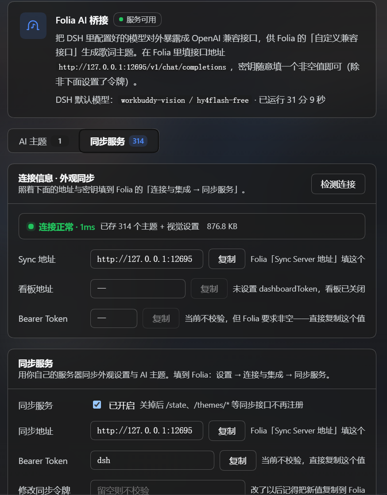

## Folia AI 桥接 v1.5.0

一个 DSH 插件：把 DeepSeek Harness 里配置好的模型暴露成 OpenAI 兼容接口供 Folia 生成 AI 歌词主题，并自带协议兼容的 Folia 同步服务。**装一个插件，Folia 的 AI 主题和外观同步都齐了。**

### 功能

- **AI 主题**：Folia 用「自定义兼容接口」走 DSH 的模型，不用另配 API 密钥；支持流式、模型回落、思考强度控制。
- **外观同步**：内置 `folia-major/sync-server` 完整协议（256 分桶、增量哈希），主题与视觉设置跨设备同步。
- **一键复制**：设置页把所有要填到 Folia 的地址、模型名、密钥都摆出来，点「复制」即可。
- **真实自检**：「检测连接」会真跑一次模型请求 + 真读一次同步库，分别报告 AI / 同步状态。
- **用量统计**：请求次数、输入/输出 token、成功率、按模型分组明细、最近 20 条请求。
- **性能**：空闲零定时器、配置预解析、模型元信息缓存、流式攒批写。

### 截图

### 安装

1. 下载下面的 `local-folia-ai-bridge-1.5.0.tgz` 并解压，或 `git clone https://github.com/songdongze/folia-ai-bridge.git`
2. DSH → **插件** → **添加插件** → 选择插件目录
3. 设置里出现「Folia AI 桥接」即安装成功

### 接到 Folia

在插件设置页的两个「连接信息」卡片里，把显示的值**复制到** Folia：

- **AI 主题栏** → Folia「设置 → AI 服务」：接口地址、模型名、API 密钥
- **同步服务栏** → Folia「设置 → 连接与集成 → 同步服务」：Sync Server 地址、Bearer Token

插件只负责展示这些信息，不会自动写入 Folia。

> 地址跑在 DSH 自己的 Web 端口上（设置页会显示实际地址，例如 `http://127.0.0.1:12695`），照着复制即可。

### 隐私

不收集或上传任何数据；用量只存在本机内存，重启即清零；配置只写入自己的 DSH profile。截图与文档不含任何真实密钥。

### 许可

MIT
